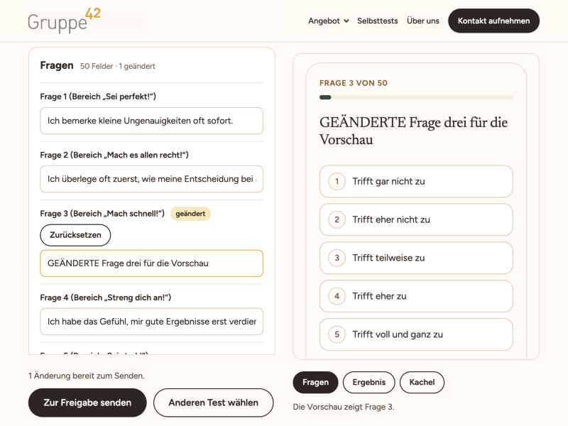

# Anleitung: Texte der Selbsttests bearbeiten

Mit dem Test-Editor ändern Sie die Texte Ihrer Selbsttests selbst, direkt im Browser, am Computer oder am Handy.
Er liegt unter **gruppe42.seitenschwung.com/editor/**. Ihre Änderung geht erst online, wenn Seitenschwung sie freigegeben hat.
Sie können also nichts kaputt machen.

## 1. Anmelden
Vorher einmal: Seitenschwung muss Ihr GitHub-Konto für den Editor freischalten. Geben Sie dazu Seitenschwung Ihren GitHub-Benutzernamen;
bis das erledigt ist, können Sie keine Änderungen senden.

Öffnen Sie die Adresse oben und wählen Sie **Mit GitHub anmelden**. Melden Sie sich mit Ihrem GitHub-Konto an
(einmal erlauben Sie dem Editor den Zugriff). Danach steht oben „Angemeldet als …“. Mit **Abmelden** melden Sie sich wieder ab.

## 2. Test wählen
Unter „Welchen Test möchten Sie bearbeiten?“ sehen Sie Ihre Tests. Klicken Sie beim gewünschten Test auf **Bearbeiten**.
Mit **Anderen Test wählen** (unten beim Bearbeiten und nach dem Senden) kommen Sie zu dieser Liste zurück; Ihr Entwurf bleibt dabei gespeichert.

## 3. Text ändern
Die Texte sind nach Abschnitten geordnet (zum Beispiel „Startseite des Tests“ und die einzelnen Fragen). Klicken Sie in ein Feld und schreiben Sie.
Geänderte Felder sind mit „geändert“ markiert; **Zurücksetzen** holt den alten Text zurück.
Ihr Entwurf bleibt in diesem Browser gespeichert, auch wenn Sie die Seite schließen. Hat sich ein Feld inzwischen auf der Seite geändert,
wird Ihr Entwurf für dieses Feld nicht übernommen; ein Hinweis nennt dann die betroffenen Felder.

Am Handy wechseln Sie mit **Bearbeiten** und **Vorschau** zwischen den beiden Ansichten:

## 4. Vorschau
Die Vorschau zeigt, wie der Test mit Ihrem neuen Text aussieht. Mit **Fragen**, **Ergebnis** und **Kachel** wählen Sie,
was Sie sehen: die Fragen, die Ergebnisseite oder die Kachel in der Übersicht der Selbsttests.

Hinweise erscheinen unter den Feldern, etwa wenn ein Text zu lang ist oder etwas nicht erlaubt ist (z. B. Links). Solange Hinweise offen sind,
steht auf dem Knopf „Noch … Hinweise offen“. Ein Klick auf den Hinweis springt zum Feld.

## 5. Zur Freigabe senden
Klicken Sie auf **Zur Freigabe senden**. Sie sehen eine Liste Ihrer Änderungen (alt → neu) und können eine **Notiz an Seitenschwung** schreiben.
Mit **Jetzt senden** geht Ihre Änderung zur Freigabe an Seitenschwung; **Abbrechen** schließt das Fenster.

## 6. Status
Nach dem Senden sehen Sie unter „Stand“, wie es weitergeht:
- **Wartet auf Freigabe**: Seitenschwung hat Ihre Änderung noch nicht geprüft.
- **Freigegeben, geht live**: Ihre Änderung ist freigegeben und wird gerade veröffentlicht.
- **Live**: die Änderung ist auf der Seite sichtbar.
- **Geschlossen, nicht freigegeben**: die Änderung wurde nicht übernommen; fragen Sie bei Seitenschwung nach.

Mit **Status aktualisieren** fragen Sie neu ab. Wartet für einen Test schon eine Änderung, arbeiten Sie an diesem Stand weiter;
beim erneuten Senden kommt Ihre neue Änderung dazu (Ihre Notiz geht dann als Kommentar an Seitenschwung).

## Was hier nicht geht
Fragen hinzufügen oder entfernen, die Auswertung oder die Stufengrenzen ändern, Bilder tauschen oder neue Tests anlegen
ist im Editor nicht möglich. Schreiben Sie dafür bitte an Seitenschwung.
Auch „Kein Zugriff“ oben auf der Seite heißt: Ihr Konto darf noch nicht senden. Dann wenden Sie sich ebenfalls an Seitenschwung.
