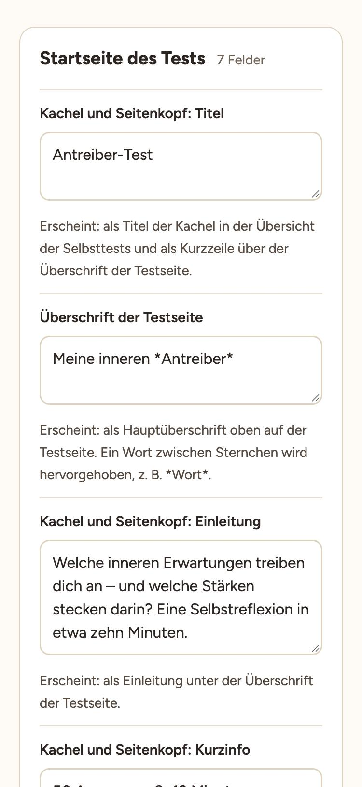
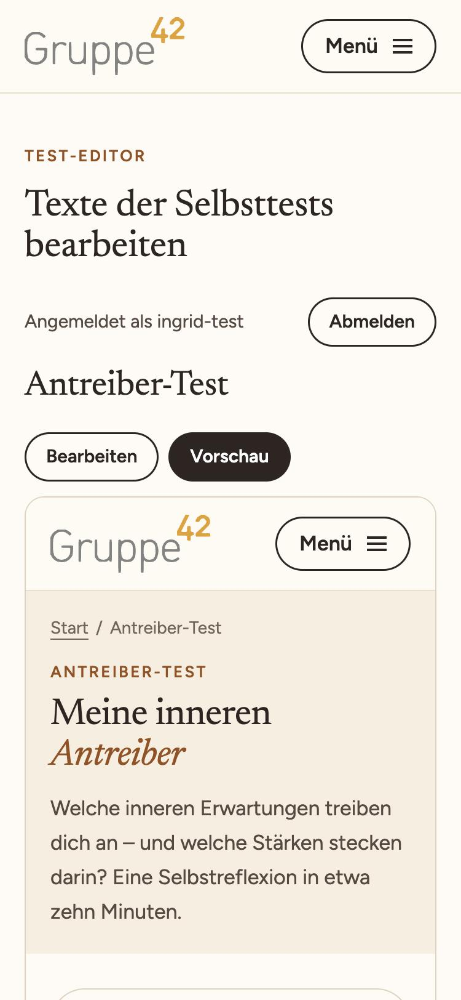

# Anleitung: Texte der Selbsttests bearbeiten

Mit dem Test-Editor ändern Sie die Texte Ihrer Selbsttests selbst, direkt im Browser, am Computer oder am Handy.
Er liegt unter **gruppe42.seitenschwung.com/editor/**. Ihre Änderung geht erst online, wenn Seitenschwung sie freigegeben hat.
Sie können also nichts kaputt machen.

## Einmalig einrichten
Das machen Sie nur beim ersten Mal; Seitenschwung hilft Ihnen dabei gern.
1. **GitHub-Konto anlegen** auf github.com (kostenlos). Teilen Sie Seitenschwung Ihren Benutzernamen mit.
2. **Passkey einrichten**: GitHub verlangt einen zweiten Faktor. Ein Passkey (Fingerabdruck, Gesichtserkennung oder Bildschirmsperre
   Ihres Geräts) ist einfacher als eine Authenticator-App. Sie finden ihn in GitHub unter Einstellungen, „Password and authentication“.
3. **Einladung annehmen**: Seitenschwung lädt Sie zum Projekt ein; Sie bekommen eine E-Mail von GitHub. Öffnen Sie sie und bestätigen Sie die Einladung.
   Bis dahin zeigt der Editor „Kein Zugriff“.
4. **Erstes Anmelden**: GitHub zeigt einmal einen englischen Dialog. Bestätigen Sie ihn mit **Authorize**.

GitHub schreibt Ihnen englische E-Mails. „merged“ heißt: Ihre Änderung ist freigegeben.

## 1. Anmelden
Öffnen Sie **gruppe42.seitenschwung.com/editor/** und wählen Sie **Mit GitHub anmelden**. Danach steht oben „Angemeldet als …“.
Mit **Abmelden** melden Sie sich wieder ab; die Anmeldung wird dabei auch bei GitHub widerrufen. Nutzen Sie das besonders an fremden Geräten.

## 2. Test wählen
Unter „Welchen Test möchten Sie bearbeiten?“ sehen Sie Ihre Tests. Klicken Sie beim gewünschten Test auf **Bearbeiten**.
Mit **Anderen Test wählen** (unten beim Bearbeiten und nach dem Senden) kommen Sie zu dieser Liste zurück; Ihr Entwurf bleibt dabei gespeichert.

## 3. Text ändern
Die Texte sind nach Abschnitten geordnet (zum Beispiel „Startseite des Tests“ und die einzelnen Fragen). Klicken Sie in ein Feld und schreiben Sie.
Alle Felder sind mehrzeilig sichtbar, Text müssen Sie aber als einen Absatz ohne Zeilenumbruch schreiben.
Mit dem Feld **Text suchen** finden Sie eine Stelle: Es zeigt nur passende Felder und öffnet die passenden Gruppen. Mit Esc leeren Sie die Suche.
Manche Felder haben einen Hinweis „Erscheint: …“; er sagt, wo der Text auf der Seite auftaucht. Die Felder für Kachel und Seitenkopf
heißen „Kachel und Seitenkopf: …“, die Hauptüberschrift der Testseite heißt „Überschrift der Testseite“.
Geänderte Felder sind mit „geändert“ markiert; **Zurücksetzen** holt den alten Text zurück.
Ihr Entwurf bleibt in diesem Browser gespeichert, auch wenn Sie die Seite schließen. Hat sich ein Feld inzwischen auf der Seite geändert,
wird Ihr Entwurf für dieses Feld nicht übernommen; ein Hinweis nennt dann die betroffenen Felder.

Am Handy wechseln Sie mit **Bearbeiten** und **Vorschau** zwischen den beiden Ansichten:

## 4. Vorschau
Die Vorschau zeigt, wie der Test mit Ihrem neuen Text aussieht. Mit **Fragen**, **Ergebnis** und **Kachel** wählen Sie,
was Sie sehen: die Fragen, die Ergebnisseite oder die Kachel in der Übersicht der Selbsttests.
Bei der Ergebnisseite können Sie auch „Gleichstand (kein Bereich vorne)“ wählen; so sehen Sie den Text, der erscheint,
wenn kein Bereich klar vorne liegt.

Hinweise erscheinen unter den Feldern, etwa wenn ein Text zu lang ist oder etwas nicht erlaubt ist (z. B. Links). Solange Hinweise offen sind,
steht auf dem Knopf „Noch … Hinweise offen“. Ein Klick auf den Hinweis springt zum Feld. Zu den Hinweisen zählen:
- „Bitte ohne Punkt am Ende – er wird automatisch ergänzt.“ (beim Feld „Status“)
- „Enthält unsichtbare Steuerzeichen – bitte Text neu eintippen.“ (oft nach Kopieren aus anderen Programmen)
- „Enthält Zeilenumbrüche oder Steuerzeichen – bitte als eine Zeile schreiben.“

## 5. Zur Freigabe senden
Klicken Sie auf **Zur Freigabe senden**. Sie sehen eine Liste Ihrer Änderungen (alt → neu) und können eine **Notiz an Seitenschwung** schreiben.
Mit **Jetzt senden** geht Ihre Änderung zur Freigabe an Seitenschwung; **Abbrechen** schließt das Fenster.

## 6. Status
Nach dem Senden sehen Sie unter „Stand“, wie es weitergeht:
- **Wartet auf Freigabe**: Seitenschwung hat Ihre Änderung noch nicht geprüft.
- **Freigegeben, geht live**: Ihre Änderung ist freigegeben und wird gerade veröffentlicht.
- **Live**: die Änderung ist auf der Seite sichtbar.
- **Geschlossen, nicht freigegeben**: die Änderung wurde nicht übernommen; fragen Sie bei Seitenschwung nach.

Mit **Status aktualisieren** fragen Sie neu ab. Wartet für einen Test schon eine Änderung, arbeiten Sie an diesem Stand weiter;
beim erneuten Senden kommt Ihre neue Änderung dazu (Ihre Notiz geht dann als Kommentar an Seitenschwung).
Wartet schon ein Vorschlag mit weiteren Änderungen, die nicht vom Editor stammen, erscheint: „Es gibt einen offenen Vorschlag mit weiteren Änderungen.
Seitenschwung kümmert sich darum.“ Es wird dann nichts gesendet.

## Was hier nicht geht
Fragen hinzufügen oder entfernen, die Auswertung oder die Stufengrenzen ändern, Bilder tauschen oder neue Tests anlegen
ist im Editor nicht möglich. Schreiben Sie dafür bitte an Seitenschwung.
Auch „Kein Zugriff“ oben auf der Seite heißt: Ihr Konto darf noch nicht senden, meist weil die Einladung noch nicht angenommen ist
(siehe „Einmalig einrichten“). Sie können dann trotzdem Texte ansehen und ausprobieren. Bei Fragen wenden Sie sich an Seitenschwung.
