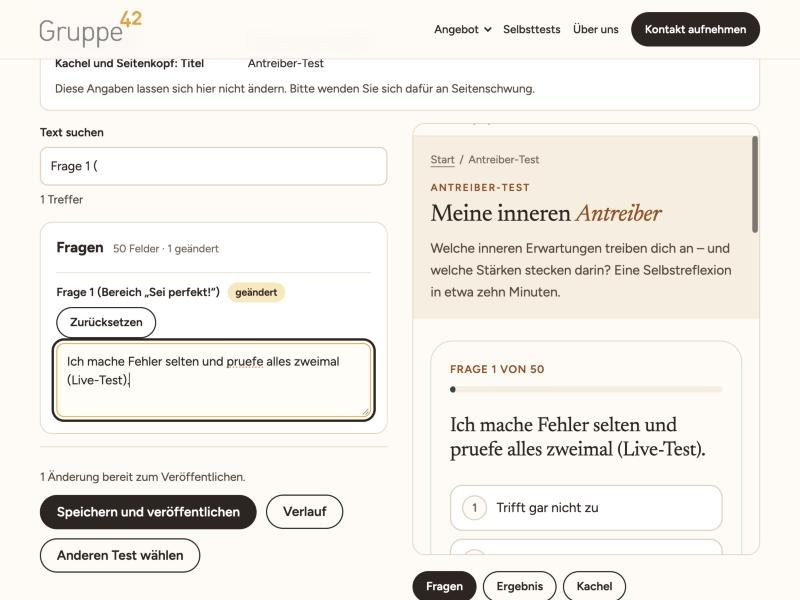
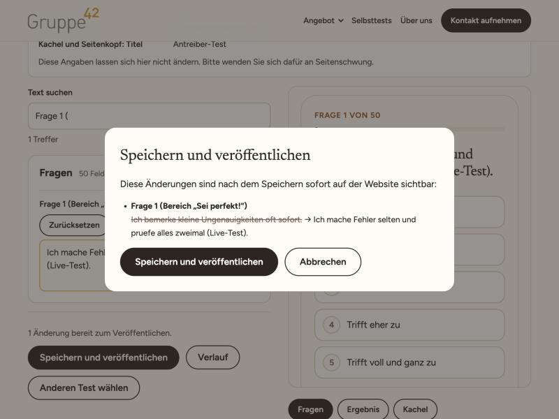
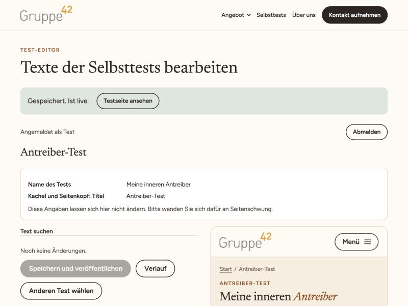

# Anleitung: Texte der Selbsttests bearbeiten

Mit dem Test-Editor ändern Sie die Texte Ihrer Selbsttests selbst, direkt im Browser, am Computer oder am Handy.
Er liegt unter **gruppe42.seitenschwung.com/editor/**. Was Sie speichern, ist **sofort auf der Website sichtbar**; es gibt keine Freigabe.
Schauen Sie deshalb vor dem Speichern in die Vorschau. Fehler lassen sich über den Verlauf rückgängig machen.

## Einrichten (einmalig pro Gerät)
1. Seitenschwung schickt Ihnen einen **Einladungslink**. Öffnen Sie ihn auf dem Gerät, das Sie künftig nutzen (Handy oder Computer).
2. Wählen Sie **Passkey einrichten** und bestätigen Sie mit Face ID, Touch ID oder der Bildschirmsperre Ihres Geräts.
   Ein Passkey ersetzt das Passwort. Danach sind Sie angemeldet.

Der Einladungslink gilt nur einmal und nur sieben Tage. Er ist danach wertlos.

## Anmelden und abmelden
Öffnen Sie **gruppe42.seitenschwung.com/editor/** und wählen Sie **Mit Passkey anmelden**; bestätigen Sie mit Face ID oder Touch ID.
Mit **Abmelden** (oben rechts) beenden Sie die Sitzung, besonders wichtig an fremden Geräten. Nach längerer Pause werden Sie automatisch abgemeldet;
ein ungespeicherter Entwurf bleibt in diesem Browser erhalten.

**Neues Gerät?** Jedes Gerät braucht einen eigenen Passkey. Bitten Sie Seitenschwung um einen neuen Einladungslink.

## Test wählen und Text ändern
Unter „Welchen Test möchten Sie bearbeiten?“ klicken Sie beim gewünschten Test auf **Bearbeiten**.
Die Texte sind nach Abschnitten geordnet (zum Beispiel „Fragen“). Klicken Sie in ein Feld und schreiben Sie; jeder Text ist ein Absatz ohne Zeilenumbruch.
Mit **Text suchen** zeigen Sie nur passende Felder. Geänderte Felder sind mit „geändert“ markiert, **Zurücksetzen** holt den alten Text zurück.

## Vorschau
Rechts (am Handy über **Vorschau** neben **Bearbeiten**) sehen Sie den Test mit Ihrem neuen Text. Mit **Fragen**, **Ergebnis** und **Kachel**
wählen Sie, was angezeigt wird: die Fragen, die Ergebnisseite oder die Kachel in der Übersicht der Selbsttests.

## Speichern und veröffentlichen
Klicken Sie auf **Speichern und veröffentlichen**. Sie sehen die Liste Ihrer Änderungen (alt → neu). Mit **Speichern und veröffentlichen** im Fenster
gehen die Änderungen sofort online, mit **Abbrechen** schließen Sie das Fenster. Danach steht oben „Gespeichert. Ist live.“;
**Testseite ansehen** öffnet die Seite.

## Verlauf und Rückgängig
**Verlauf** zeigt die letzten gespeicherten Änderungen dieses Tests, die neuesten zuerst. Bei einer Änderung klicken Sie auf **Rückgängig**
und bestätigen mit **Rückgängig machen**: Die Felder bekommen ihren vorherigen Text zurück, auch das ist sofort sichtbar.

## Hinweise und Meldungen
Hinweise stehen unter dem Feld, etwa „Bitte ohne Punkt am Ende – er wird automatisch ergänzt.“ oder
„Enthält unsichtbare Steuerzeichen – bitte Text neu eintippen.“ (oft nach Kopieren aus anderen Programmen). Solange Hinweise offen sind,
steht auf dem Knopf „Noch … Hinweise offen“.

| Meldung | Was zu tun ist |
|---|---|
| Bitte erneut anmelden. Ihr Entwurf bleibt in diesem Browser gespeichert. | Erneut mit Passkey anmelden. |
| Nicht gespeichert: Das Feld „…“ wurde inzwischen von anderer Seite geändert. Der aktuelle Stand wurde geladen. Ihr Text dafür war: „…“. | Der aktuelle Stand ist schon geladen; Ihr Text wird mit angezeigt. Prüfen Sie ihn und speichern Sie erneut. |
| Gerade wird an anderer Stelle gespeichert. Bitte versuchen Sie es in einem Moment erneut; Ihr Entwurf bleibt erhalten. | Einen Moment warten, dann erneut speichern. |
| Gespeichert, aber die Website zeigt noch den alten Text. Bitte wenden Sie sich an Seitenschwung. | Seitenschwung Bescheid geben; Ihr Text ist gespeichert. |
| Zu viele Anfragen in kurzer Zeit. Bitte warten Sie eine Minute … | Kurz warten, dann erneut versuchen. |
| Keine Verbindung. Bitte prüfen Sie Ihre Internetverbindung … | Verbindung prüfen, erneut versuchen. |
| Dieser Einladungslink ist ungültig, abgelaufen oder wurde schon verwendet. | Neuen Link bei Seitenschwung anfordern. |
| Der Editor ist derzeit nicht eingeschaltet / Speichern ist gerade nicht möglich … | Seitenschwung Bescheid geben; Ihr Entwurf bleibt erhalten. |

## Was hier nicht geht
Fragen hinzufügen oder entfernen, die Auswertung oder die Stufengrenzen ändern, den Namen und Titel eines Tests ändern, Bilder tauschen oder
neue Tests anlegen ist im Editor nicht möglich. Schreiben Sie dafür bitte an Seitenschwung.
